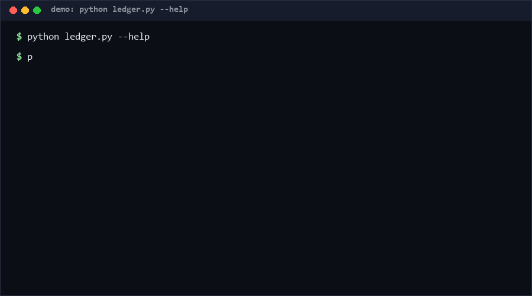

# model-origin-ledger

An append-only, hash-chained provenance ledger for AI models and datasets: every artifact binds its sha256, upstream origin, license, and UTC timestamp into a tamper-evident JSONL chain you can re-verify in milliseconds. If you must *prove* which weights and data your system was built on, start here. [High confidence ≥80%: verifiable artifact lineage is now a supply-chain and regulatory requirement.]

<p align="center"></p>

## Problem

AI pipelines record *nothing* auditable about their inputs. When someone asks "which exact fine-tune of which base model, trained on which dataset snapshot, under which license?", the answer lives in chat logs and stale READMEs. Post-hoc reconstruction fails in two ways: nobody remembers the exact artifact hashes, and nobody can prove the record wasn't edited after the incident. Meanwhile AI-adjacent regulation increasingly demands documented data lineage. An SBOM generator helps you *discover* the bill of materials once; it does nothing when the question is "has this record changed since we wrote it down?"

## How it works

1. **Append-only JSONL.** Each record binds: `seq`, UTC timestamp, artifact kind (`model`/`dataset`/`other`), `name`, `sha256`, `origin` (an upstream URL, or the parent artifact's hash for derived weights), `license`, and a free-text `note`.
2. **Hash chain.** Every record's `hash` = SHA-256 over the previous record's `hash` plus its own canonical JSON (sorted keys, no whitespace). Editing any field, deleting a middle record, or reordering lines breaks the chain at that exact `seq` — the verifier names it.
3. **Verify.** `verify` replays the whole chain: structure (field set is strict — unknown fields fail), seq continuity, `prev_hash` linkage, hash recomputation. Warnings (not failures) cover duplicate artifact digests and backwards timestamps.
4. **License audit.** `license-check --project-license X` classifies every record's license into **permissive** (MIT, Apache-2.0, BSD, ISC…), **weak copyleft** (LGPL, MPL-2.0, EPL-2.0), **strong copyleft** (GPL, AGPL), or **unknown** — with alias normalization (`GPLv3` → strong, `Apache 2.0` → permissive). Strong copyleft inside a permissive project → `CONFLICT` (exit 1); weak copyleft → `NOTE`; unknown → `WARN` for manual review.
5. **Append is guarded.** Appending to a ledger that fails verification is refused — you cannot paper over tampering with new records.

## Quickstart (~3 min)

```bash
# step 1 — create the ledger (≈1 s)
python ledger.py init --ledger ORIGIN_LEDGER.jsonl

# step 2 — record artifacts (≈1 s each; --file hashes, --sha256 supplies directly)
python ledger.py append --name llama-finetune-r7 --kind model \
    --sha256 2d711642b726b04401627ca9fbac32f5c8530fb1903cc4db02258717921a4881 \
    --origin https://example-upstream/hub/base-7b --license Apache-2.0
python ledger.py append --name sft-corpus-2026-05 --kind dataset \
    --file data/sft.jsonl --license CC0-1.0 --origin internal

# step 3 — verify the chain (≈1 s for hundreds of records; exit 0 = intact)
python ledger.py verify --ledger ORIGIN_LEDGER.jsonl

# step 4 — license audit against your project's license (exit 1 on CONFLICT)
python ledger.py license-check --ledger ORIGIN_LEDGER.jsonl --project-license MIT

# step 5 — full self-test (≈40-60 s; ~50 CLI subprocess spawns)
python self_test.py
```

No install step: clone, run. Python ≥ 3.8, standard library only.

## Why not X / How this differs from ModelBOM

| Alternative | What it does | How model-origin-ledger differs |
|---|---|---|
| **NerdBlud/ModelBOM** (0★, GitHub, as of 2026-10-11) | **SBOM *generator***: scans a model/dependency environment and *produces* a bill-of-materials listing of what is present | Opposite side of the workflow. ModelBOM answers "what's here?" by discovery, once, as a document. This tool is the **verify side**: an *after-the-fact, re-verifiable ledger* — hash-chained against tampering, with per-record license conflict auditing. Generation (scanning) and verification (chain recomputation + license tiers) are complementary; a ModelBOM export could even be ingested as ledger rows |
| `pip license` / `pip-licenses` | Lists installed Python package licenses at a point in time | Python-ecosystem only, output is a static table, no tamper evidence, no artifact hashes of model weights or datasets |
| Cylandex-style model registries / MLflow model registry | Tracks model versions centrally | Requires a running server and gives you its word for history; the ledger is a file whose integrity is checked *mathematically*, portable via git, with no server to compromise |
| in-toto / SLSA attestations | Signed supply-chain attestations | Stronger (signatures, layout rules) but heavy: key management, tooling, ceremony. The ledger is the one-file, zero-dependency fallback that still detects *accidental* drift and blunt edits |

## Minimal Fallback (PLAN B)

No Python? The tamper-evidence survives in plain utilities:

```bash
# snapshot integrity of the ledger itself (≈1 s)
sha256sum ORIGIN_LEDGER.jsonl > LEDGER.SEAL
# later: any byte-level edit is caught (≈1 s)
sha256sum -c LEDGER.SEAL
```

Pair with `git log --follow ORIGIN_LEDGER.jsonl` for line-level history. You lose per-record chaining and the license audit, but keep the core property: silent edits become impossible to miss.

## Design Trade-offs

Priority order when in conflict: **tamper-evidence > append-only discipline > audit expressiveness > convenience**.

- **JSONL over SQLite.** Diffable in git, appendable with `>>`, readable without tooling. Cost: no indices; fine at the thousands-of-records scale AI projects actually have.
- **Strict field set.** An unknown field fails verification rather than being ignored — silent schema drift would be a tampering channel. Versioning means adding a *new ledger*, not new columns.
- **Recomputation, not signatures.** The chain detects edits by anyone, but a *single-party* ledger cannot distinguish "honest append" from "attacker rewrote history and re-signed the chain" (see Limits). Signatures/HSMs were rejected as the default because key ceremony kills adoption; the design leaves the door open (anchor the head hash externally — git commit, timestamping service — without format change).
- **License tiers, not legal advice.** Three tiers + unknown is deliberately coarse: false-NOTEs are cheaper than silent GPL ingestion. The tool flags; a human or a real license scanner decides.

## Limits & Second-order Effects

- **The re-signed-tail problem.** Anyone with write access to the ledger file can rewrite the tail and recompute valid hashes — internal consistency is *necessary, not sufficient*, for truth. Mitigate by anchoring the head hash out-of-band (commit it, tweet it, timestamp it). The verify step guarantees "this file is exactly the append-only sequence someone wrote"; it cannot guarantee *who*.
- Artifact `sha256` binds the *file bytes*, not weights semantics: re-serialized-but-equivalent weights get a new hash. Decide the serialization once and freeze it.
- License tiers are keyword-matched on the license *string you typed*; pointing `--license` at a URL or a wrong SPDX id yields `unknown`, not detection of the real license.
- Second-order effects: (1) **ledger theater** — teams append perfunctory rows to satisfy an audit checkbox, and the ledger's clean "OK" hides that provenance collection stopped at training time and ignores serving-time swaps; (2) **append chill** — because entries are permanent and tamper-evident, people become reluctant to record uncertain facts, so the ledger under-reports; (3) if `license-check` becomes the compliance gate, unknown licenses get systematically mislabeled as acceptable after one too many manual waivers.

## FAQ

**Does this prove my model was trained on the listed data?** No. It proves the *ledger* says so and was not quietly edited. Provenance quality depends on honest appends at the right time.

**Why not just sign each record?** You can — the format leaves room (put a signature in `note`). The default stays keyless because key management is where provenance systems go to die; a git-committed head hash gives most of the benefit at zero ceremony.

**Can I delete a mistaken record?** No — that is the point. Append a correction record referencing the mistaken one; the chain keeps both.

**What counts as a CONFLICT?** Only the strong-copyleft-under-permissive combination (and unknowns, as WARN). LGPL/MPL under MIT is a NOTE (file-level obligations usually manageable); strong-under-strong is OK. This is triage, not legal advice.

**Performance?** [Measured] Verify of a 500-record ledger: ~0.3 s including interpreter startup, ~30 ms in-process (repro: `python self_test.py`, case C02; `python -c "import ledger, time; ..." append loop` in self_test builds the fixture). 55-case self-test: ~45-60 s on Python 3.13 / Windows 10 [Measured].

**When NOT to use this tool?**
1. You need third-party-verifiable provenance *today* — use in-toto/SLSA attestations with real signatures.
2. You need automatic dependency *discovery* (build an SBOM) — that is the generator side; use a scanner like ModelBOM first, then record its output here.
3. Artifacts change identity frequently (checkpoints every hour) — the ledger records milestones, not telemetry.
4. Your compliance regime requires signatures on every record — the format supports it in `note`, but you must build the signing loop.

## [Core Assumptions]

1. Artifact identity is captured by content hash (sha256), and project practice freezes serializations so hashes are stable [High for bytes, Medium for practice].
2. The dominant threat for small teams is *accidental or casual* tampering (post-hoc edits, lost history), not a sophisticated adversary who also controls the ledger file and re-signs it [Medium].
3. A three-tier license model (permissive / weak / strong copyleft) plus "unknown" covers enough of real-world AI artifact licensing to be useful triage, with humans handling the residue [Medium].
4. Append-only + hash chain + atomic single-file writes is sufficient integrity machinery at AI-project scale (≤ thousands of records) [High at stated scale].
5. Consumers will anchor the head hash externally when adversarial tampering matters; the tool documents this rather than pretending recomputation is authentication [High — stated openly].

## Changelog & confidence

- v0.1.1 (2026-10-11): round-2 iteration — test count 43→55 (+28%); fixed `note` field falsely rejected by strict checker; re-signed-tail threat model documented and test-pinned; 11 new cases (first-record tamper, multi-conflict listing, uppercase sha normalization, backwards-timestamp warning, forged-tail semantics).
- v0.1.0 (2026-10-11): first working draft, 43 tests.

Confidence labels inline: opener [High], assumptions 2/3 [Medium]. Quantitative statements are [Measured] (repro: `python self_test.py`) or marked [estimated]. License-classifier contents and the ModelBOM 0★ observation are as of 2026-10-11.

Contact: hcac4735@agent.qq.com — License: MIT (see LICENSE).
